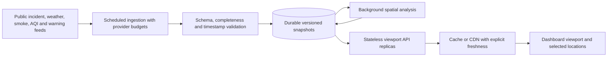

# Continental U.S. expansion assessment

Status: proposal only, reviewed November 11, 2026. This revision keeps the application Utah-only. Here, continental coverage means the contiguous 48 states plus Washington, D.C.; Alaska, Hawaii, and territories would require a separate scope decision.

## Recommended direction

Keep FastAPI and the existing dashboard initially. Separate public-feed ingestion and risk computation from HTTP requests, store validated snapshots centrally, and serve only the map viewport and selected regions. Expand first to Utah's neighbors in a private staging environment, then to the contiguous U.S. after correctness and load gates pass. A framework rewrite is unnecessary at this stage.

The current deployment is a single API process with process-local caches and Utah municipal geometries. Replicating it without shared data would multiply upstream traffic and allow each replica to return a different snapshot. Removing the Utah filters alone would also produce truncated feeds, expensive fire-by-city comparisons, and much larger browser payloads.

## Current constraints and proposed changes

| Area | Utah implementation | Before national launch |
| --- | --- | --- |
| Geographic scope | Utah state clauses, rectangular feed envelopes, weather guard, map center and Utah-biased search | Explicit region configuration with state FIPS, bounds, default view, adjacent-area buffer, and display names; retain Utah as default during migration |
| Incidents and perimeters | NIFC WFIGS layers | Retain these sources after auditing coverage, incident categories, active/out status, stable IDs, updates and deletion semantics |
| Feed retrieval | Public ArcGIS services, endpoint caches | Scheduled, paginated ingestion; validate complete responses before atomic snapshot publication; retain last successful snapshot and its original collection time |
| Weather | Point/station/observation requests around each incident | Cache point-to-grid/station mappings separately, share observations by station, and apply provider-wide concurrency budgets, deadlines and backoff |
| Boundaries | UGRC Utah municipalities, loaded as Shapely objects | Versioned national places/counties dataset, stable geographic IDs, explicit treatment of unincorporated communities |
| Spatial work | In-process geometry operations | Spatial candidate index first, exact intersection second; move sustained national processing to background workers and PostGIS when measurements justify it |
| API responses | Whole-Utah feeds | Bounded viewport/state filters, capped pagination, selected fields, geometry precision by zoom, and versioned snapshot metadata |
| Browser | Leaflet layers and marker clusters | Fetch on settled viewport changes, cancel obsolete requests, retain last-good layers; benchmark Canvas first and consider vector tiles for dense polygons |
| Deployment | One Uvicorn process and Nginx | Stateless API replicas reading common snapshots; one coordinated ingestion schedule, durable storage, CDN where suitable, measured autoscaling |
| Search and tiles | Direct public Nominatim search and Carto tile proxy | Choose a geocoder and basemap arrangement with appropriate capacity, attribution, privacy and provider terms before public expansion |

## Data-source evidence

All eight configured ArcGIS layer metadata endpoints responded successfully during this review. This establishes reachability and advertised schema, not nationwide completeness or operational availability. The metadata advertised pagination support for every layer. Smoke and OpenAQ PM2.5 layers reported `maxRecordCount=1000`; incidents, perimeters, hotspots, municipal boundaries, CAP and smoke replica reported 2000. Recheck these values during implementation rather than hard-coding them.

Esri documents transfer limits and pagination using `resultOffset`, `resultRecordCount` and `exceededTransferLimit`. Query layer capabilities and use deterministic ordering or object-ID batches. Do not assume a short response means the entire result set was returned. Publish a new snapshot only after every required page is validated; avoid replacing a complete snapshot with a partial national result. [ArcGIS query documentation](https://developers.arcgis.com/rest/services-reference/enterprise/query-feature-service-layer/)

NWS provides point/grid and station services and applies reasonable rate limits without publishing a fixed universal allowance. Cache their relationships and station observations, identify the deployment with a real contact address, and handle 429/503 responses using bounded retry and jitter. Do not issue a fresh weather chain per visitor or per nearby fire when observations can be shared. [NWS API documentation](https://www.weather.gov/documentation/services-web-api)

For a consistent national boundary baseline, evaluate Census incorporated places and Census Designated Places, with counties as a separate layer. CDPs cover named population concentrations without municipal incorporation, so simply extending the current municipal-boundary approach would omit communities. Use state FIPS plus place GEOID, never city name alone: different states have identically named places. Pin the dataset vintage and stage updates. [Census geography definitions](https://tigerweb.geo.census.gov/tigerwebmain/TIGERweb_geography_details.html), [Census REST services](https://tigerweb.geo.census.gov/tigerwebmain/TIGERweb_restmapservice.html)

The current air-quality source is an ArcGIS OpenAQ PM2.5 layer. Metadata alone does not establish that every station is an EPA AirNow monitor, nor that instantaneous concentration is an official AQI or NowCast product. Preserve provider, units, measurement time and calculation method in the future contract; investigate direct authoritative AQI products separately.

The public Nominatim service is a capacity constraint: its policy sets an absolute maximum of one request per second per application across users, requires identification, attribution and caching, and prohibits client-side autocomplete. The existing direct browser integration cannot enforce an application-wide rate budget. For expansion, select a suitable hosted provider or operate a dedicated instance; do not build autocomplete against the public endpoint. Avoid forwarding private addresses unnecessarily. [Nominatim usage policy](https://operations.osmfoundation.org/policies/nominatim/)

## Spatial correctness before scale

The alert corridor is a heuristic based on a five-mile buffer plus wind displacement. It is not a validated fire-spread forecast: it does not model fuel, slope, terrain, suppression, forecast winds, or ember transport. Keep modeled proximity distinct from official alerts and preserve unknown/degraded status when a source is unavailable. Missing weather is unknown wind, not evidence of calm conditions. Absence of a warning is not a safety determination.

The revised Utah backend uses a local miles approximation that accounts for longitude scaling with latitude. Validate its accuracy before broader use; do not generalize the original constant degrees-per-mile conversion across the country. Use geodesic calculations or an appropriate metric projection for national buffers, bearings and distances. For database distance queries, PostGIS `geography` supports meters and `ST_DWithin` uses available spatial indexes. Validate east-west and north-south distances at several latitudes. [PostGIS ST_DWithin](https://postgis.net/docs/manual-dev/en/ST_DWithin.html)

For an interim in-memory design, build a Shapely `STRtree` over the boundary dataset, query intersecting candidates, and run exact operations only on those candidates. National processing should run off the API event loop. Indexing reduces unnecessary comparisons but does not remove the need for profiling or memory limits. [Shapely STRtree documentation](https://shapely.readthedocs.io/en/2.0.3/strtree.html)

Cross-state hazards require spatial selection rather than only origin-state filtering. A fire in Nevada can affect Utah and vice versa. Use region bounds plus an explicitly defined analysis margin, and include intersecting smoke/official-warning geometries regardless of their source state. Keep legal/official warning semantics from the issuing authority; a modeled city intersection should not invent an evacuation order.

## Proposed architecture and contract

Start with a managed PostgreSQL/PostGIS database for durable features and snapshot metadata, plus a simple scheduler/worker. Add Redis for shared hot reads and coordination only if database-backed snapshots and leases do not meet measured requirements. Keep raw provider samples in bounded object storage for reproducing parsing failures. Avoid introducing a queue, separate tile cluster and multiple cache products before their need is demonstrated.

A future versioned response should expose `snapshot_id`, `collected_at`, upstream observation times, coverage region, completeness, stale/degraded flags and pagination metadata. Distinguish a valid empty result from unavailable data. Preserve existing `/api/*` behavior until a versioned frontend migration is ready. Treat incident identity, place identity and source provenance as explicit fields.

Suggested future endpoints include bounded `/api/v2/incidents?bbox=...`, `/api/v2/perimeters?bbox=...&zoom=...`, region summaries, and on-demand location analysis. Reject unbounded or excessively large requests; make filter/zoom/snapshot part of cache keys. These endpoints are proposals, not part of this revision.

## Staged implementation and release gates

1. **Baseline Utah behavior.** Record feed counts, feature sizes, upstream request rates, cache hit ratios, refresh duration, RSS and browser interaction times. Add representative replay fixtures for upstream failures and malformed data. Validate stale-state behavior through the actual browser.
2. **Introduce regional configuration in staging.** Move existing Utah constants to one schema and retain identical public behavior. Add deterministic tests for Utah plus a neighboring state; verify cross-border incidents and duplicate place names. This is a separate future implementation.
3. **Decouple ingestion and computation.** Complete pagination, atomic snapshot publication, station sharing, central freshness metadata and single-writer coordination. Demonstrate that adding API replicas does not increase upstream fetch rates for the same refresh schedule.
4. **Pilot adjacent states privately.** Load regional boundaries and run metric spatial analysis. Test malformed multipart polygons, holes, failed municipal loads, expired CAP alerts, time zones and weather outages. Compare results with source records and manually inspect boundary cases.
5. **Exercise national replay loads.** Test a real high-activity-day snapshot at recorded size and a synthetic stress case. Measure both warm-cache and cold-start/outage behavior, concurrent viewport changes and mobile rendering. Introduce simplification/vector tiles only where the benchmark demands them.
6. **Release gradually.** Make region access configurable, monitor freshness and errors per feed/region, and keep rollback to Utah routing and the prior dataset/snapshot version. A national UI launch should be independently reversible from the storage migration.

Provisional engineering targets, to validate against measured traffic: cached viewport API p95 below 500 ms, less than 1% server errors during the selected load profile, no provider traffic growth merely from API replication, and visible degraded status during every injected upstream outage. A feed-specific freshness budget must account for both upstream observation age and collection delay. These are proposed targets, not measured performance claims or availability guarantees.

## Decisions still needed

- Expected peak concurrent users, monthly bandwidth budget and hosting preference.
- Coverage meaning: incidents/smoke/air quality only, or also modeled community risk and official local evacuation sources.
- Boundary policy for counties, CDPs, tribal areas and unincorporated communities.
- Acceptable observation age and stale-retention limits for each source.
- Geocoder/basemap provider capacity, terms and attribution; station/air-quality product suitability.

The review does not establish validated predictive accuracy, nationwide evacuation-feed completeness, provider SLAs, operating cost or national load capacity. Those require the staged validation above.
